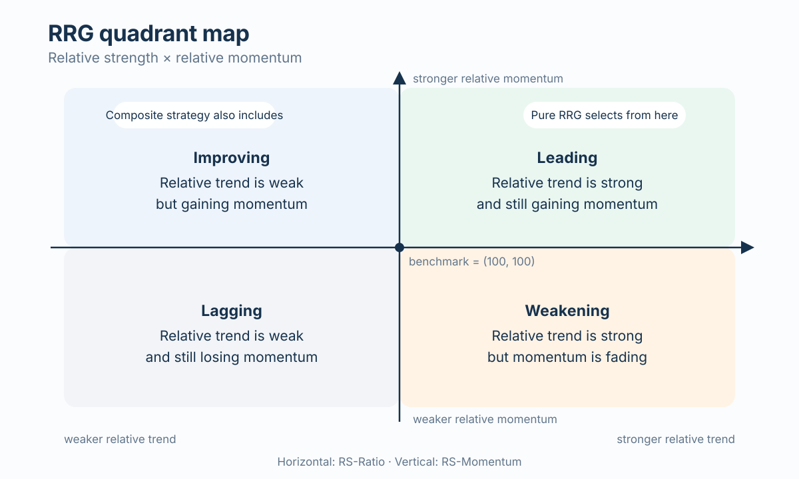
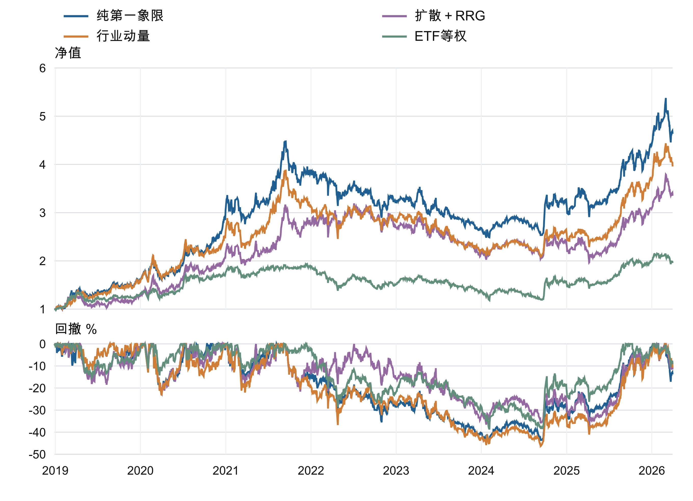

# RRG 行业与 ETF 轮动研究

[English](https://github.com/skyexry/rrg-etf-rotation/tree/main)

本仓库复现西部证券《相对旋转图 RRG 框架下的行业和 ETF 轮动策略》，并在统一数据、交易费用和执行规则下比较四种策略：

- 纯 RRG 第一象限 ETF 策略
- 扩散指标 + RRG 复合策略
- 行业动量 ETF 策略
- ETF 等权基准

研究进一步检验时间稳定性、交易成本、参数敏感性、统计显著性，以及 10 个月均线风控对照。仓库同时保存 Journal of Finance 排版的五页英文报告、中文完整报告、客户阅读版和可核验的结果文件。

## 框架如何运作



RRG 将相对趋势强度与相对趋势动能分开衡量。纯 RRG 策略只从领先象限选择行业；复合策略完成扩散指标筛选后，也会纳入改善象限。


四种策略采用同一月末信息集和下一交易日开盘执行规则。Q、C、M 先选择行业，再映射为可执行的 ETF 组合；E 直接对可交易 ETF 集合等权配置。

## 主要结果

样本期为 2018-12-28 至 2026-03-31，主设定采用月度调仓、信号后下一交易日开盘成交、买卖各 3bp、现金收益为 0。

| 策略 | 年化收益 | 年化波动 | 夏普比率 | 最大回撤 |
| --- | ---: | ---: | ---: | ---: |
| 纯 RRG 第一象限 | **24.62%** | 26.36% | **0.967** | -44.76% |
| 扩散指标 + RRG | 18.95% | 27.02% | 0.778 | **-38.40%** |
| 行业动量 | 21.83% | 25.92% | 0.892 | -46.19% |
| ETF 等权 | 10.12% | **19.68%** | 0.588 | -38.78% |



纯第一象限策略在主设定下取得最高历史年化收益和夏普比率。相对行业动量，它的年化收益高 2.79 个百分点，波动率略高，最大回撤改善约 1.44 个百分点。1,000 万元期末增长至 4,636 万元，行业动量对应 3,958 万元。两者月均收益差检验约为 `p=0.468`，因此历史经济表现与持续统计增量分开报告。主参数也是所检验网格中纯第一象限策略表现最高的一组。

## 稳健性一览

| 检验 | 纯 RRG 结果 | 解读 |
| --- | --- | --- |
| 单边交易成本 20bp | 年化收益 21.49%，行业动量为 19.27% | 在所检验成本范围内，收益排序保持一致 |
| 3×3 参数网格 | 年化收益 12.73%–24.62%；9 组中有 6 组超过对应行业动量 | 经济表现覆盖多组设定，幅度随参数明显变化 |
| 12 个月滚动窗口 | 76 个窗口中 29 次排名第一，47 次超过行业动量 | 优势出现在多个时期，同时具有时间差异 |
| Q−M 统计证据 | 年化差值 +2.79 个百分点；HAC `p=0.468`；区块自助法 95% 区间 `[-4.85, 10.76]` 个百分点 | 持续增量表现仍存在较大估计不确定性 |
| 10 个月均线风控 | 年化收益 16.34%，最大回撤 -47.04% | 固定过滤器在本样本中降低收益并扩大实际回撤 |

完整证据见[实验结论](results/先看这个_实验结论.txt)、[结果表格](results/01_结果表/)和[英文技术附录](reports/english/RRG_Technical_Appendix.pdf)。

## 仓库结构

```text
src/                         RRG 数据、回测、稳健性和核验脚本
vendor/quantsplaybook_rrg/   固定上游 commit 的算法实现与测试
reports/english/             JF 风格英文正文、技术附录和 TeX 源码
reports/chinese/             中文报告、完整附录和可编辑 Word 文件
reports/client/              面向非量化客户的阅读版本
results/                     最终表格、图表、净值记录与核验清单
data/                        数据取得与复现说明
```

结果阅读入口为 [`results/先看这个_实验结论.txt`](results/先看这个_实验结论.txt)，完整口径见 [`results/数据与策略口径.txt`](results/数据与策略口径.txt)。

## 报告

- [Journal of Finance 排版英文报告](reports/english/RRG_Report.pdf)
- [英文技术附录](reports/english/RRG_Technical_Appendix.pdf)
- [中文精简研究报告](reports/chinese/中文研究报告_精简阅读版.pdf)
- [中文完整检验与数据附录](reports/chinese/完整检验与数据附录.pdf)

## 环境

建议使用 Python 3.12：

```bash
python -m venv .venv
source .venv/bin/activate
pip install -r requirements.txt
```

运行合成数据测试：

```bash
PYTHONPATH=vendor/quantsplaybook_rrg pytest vendor/quantsplaybook_rrg/tests -q
PYTHONPATH=src pytest src/test_rrg_pipeline.py -q
```

完整历史回测依赖授权数据快照。数据文件的准备方式和当前覆盖边界见 [`data/README.md`](data/README.md)。仓库内的最终结果与报告可以直接审阅，输入数据库和原始接口数据保留在本地。

## 数据与证据边界

- 2018/2019 年行业归属约覆盖 55.93%/59.97% 的股票日，对应自由流通市值覆盖约 35.55%/41.89%。
- ETF 持仓记录的完整度随报告期变化，历史产品分类和跟踪指数身份也存在覆盖差异。
- 回测加入已退市 ETF，并按事前约定的净值近似处理无法取得交易价格的退出事件。
- 结果来自同一历史样本；成本、参数和时间窗口分析属于样本内稳定性证据。
- 本项目用于研究与教学，不构成投资建议。

## 来源

RRG 算法实现参考 [hugo2046/QuantsPlaybook](https://github.com/hugo2046/QuantsPlaybook)，固定 commit `3f83a77f4c7996ed8185b8979a42c4372c1d811f`。文件来源与哈希记录见 [`vendor/quantsplaybook_rrg/UPSTREAM.json`](vendor/quantsplaybook_rrg/UPSTREAM.json)。

