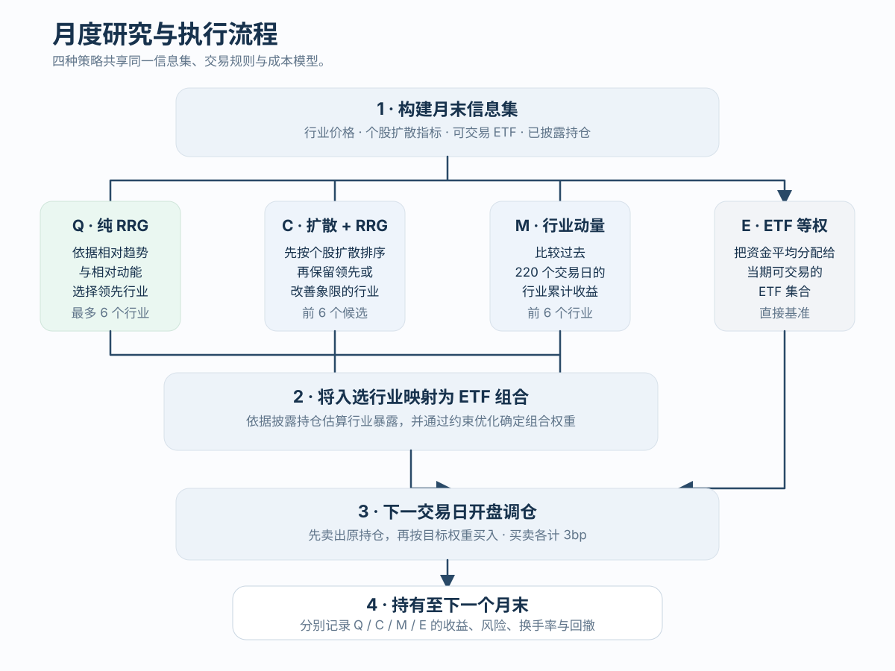
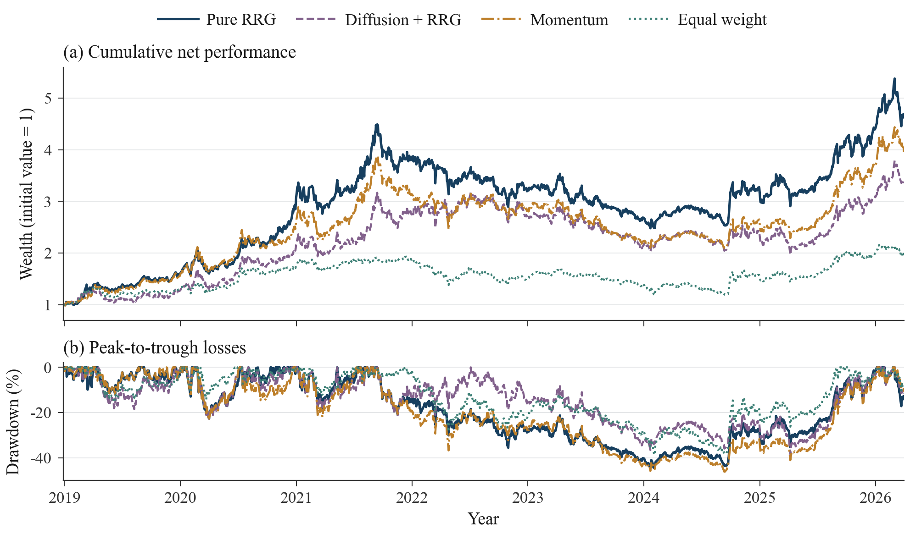

# RRG Sector and ETF Rotation

[中文版本](https://github.com/skyexry/rrg-etf-rotation/tree/zh-CN)

This repository reconstructs the sector and ETF rotation framework from Western Securities' *Sector and ETF Rotation under the Relative Rotation Graph (RRG) Framework*. It evaluates four strategies under a common data set, trading-cost model, and execution convention:

- Pure RRG Leading-Quadrant ETF strategy
- Breadth + RRG composite strategy
- Industry-momentum ETF strategy
- Equal-weight ETF benchmark

The study also examines performance over time, trading-cost sensitivity, parameter robustness, statistical uncertainty, and a fixed ten-month moving-average risk-control overlay. The repository includes a five-page Journal of Finance-style English report, a separate technical appendix, full Chinese reports, a client-facing explanation, and auditable result files.

## How the framework works


The RRG map separates relative trend strength from its momentum. The pure RRG strategy selects only from the leading quadrant; the composite strategy also admits improving sectors after its breadth screen.



All four strategies use the same month-end information set and next-open execution convention. Q, C, and M first select sectors and then map them into implementable ETF portfolios; E directly equal-weights the eligible ETF universe.

## Main results

The sample runs from December 28, 2018 to March 31, 2026. The main specification rebalances monthly, trades at the next trading day's open after signal formation, charges 3 basis points on each purchase and sale, and assigns a zero return to cash.

| Strategy | Ann. return | Ann. volatility | Sharpe | Max. drawdown |
| --- | ---: | ---: | ---: | ---: |
| Pure RRG Leading Quadrant | **24.62%** | 26.36% | **0.967** | -44.76% |
| Breadth + RRG | 18.95% | 27.02% | 0.778 | **-38.40%** |
| Industry Momentum | 21.83% | 25.92% | 0.892 | -46.19% |
| ETF Equal Weight | 10.12% | **19.68%** | 0.588 | -38.78% |



The pure leading-quadrant strategy has the highest historical annualized return and Sharpe ratio in the main specification. Relative to industry momentum, it adds 2.79 percentage points of annualized return, has slightly higher volatility, and improves maximum drawdown by about 1.44 percentage points. CNY 10 million grows to CNY 46.36 million, versus CNY 39.58 million for momentum. Its monthly mean-return difference relative to momentum has `p ≈ 0.468`, so the historical economic advantage and evidence of a persistent incremental return are reported separately. The main 220-day/six-industry setting is also the best pure-RRG result within the tested parameter grid.

## Robustness at a glance

| Check | Pure RRG result | Interpretation |
| --- | --- | --- |
| 20 bp one-way cost | 21.49% annualized, versus 19.27% for momentum | The return ranking survives the tested cost range |
| 3×3 parameter grid | 12.73%–24.62%; exceeds matched momentum in 6/9 cases | The economic result spans several settings, while its magnitude varies materially |
| Rolling 12-month windows | Ranks first in 29/76; exceeds momentum in 47/76 | The advantage appears across multiple periods and is not universal |
| Q−M statistical evidence | +2.79 pp annualized; HAC `p=0.468`; block-bootstrap 95% CI `[-4.85, 10.76]` pp | Persistent incremental performance remains imprecisely estimated |
| Ten-month SMA overlay | 16.34% return and -47.04% drawdown | The fixed filter reduces return and worsens realized drawdown in this sample |

Full evidence is available in the [experiment summary](results/EXPERIMENT_SUMMARY.md), [result tables](results/01_results_tables/), and [technical appendix](reports/english/RRG_Technical_Appendix.pdf).

## Repository map

```text
src/                         Data, backtest, robustness, and validation scripts
vendor/quantsplaybook_rrg/   Upstream implementation pinned to a fixed commit
reports/english/             Five-page report, appendix, PDFs, and TeX sources
reports/chinese/             Chinese reports, notes, and client-facing version
results/01_results_tables/   Performance, robustness, and inference tables
results/02_figures/          English figures in PNG and PDF formats
results/03_return_records/   Daily/monthly NAV and scenario records
results/04_validation/       Run settings, hashes, and validation readbacks
data/                        Data requirements and snapshot identification
```

Start with [`results/EXPERIMENT_SUMMARY.md`](results/EXPERIMENT_SUMMARY.md). Detailed implementation and evidence conventions are documented in [`results/DATA_AND_METHODS.md`](results/DATA_AND_METHODS.md).

## Reports

- [Journal of Finance-style English report](reports/english/RRG_Report.pdf)
- [English technical appendix](reports/english/RRG_Technical_Appendix.pdf)
- [Chinese concise report](reports/chinese/中文研究报告_精简阅读版.pdf)
- [Chinese full validation appendix](reports/chinese/完整检验与数据附录.pdf)

## Environment and tests

Python 3.12 is recommended:

```bash
python -m venv .venv
source .venv/bin/activate
pip install -r requirements.txt
```

Run the synthetic-data test suites:

```bash
PYTHONPATH=vendor/quantsplaybook_rrg pytest vendor/quantsplaybook_rrg/tests -q
PYTHONPATH=src pytest src/test_rrg_pipeline.py -q
```

The complete historical run requires an authorized research-data snapshot. Input preparation and the snapshot identifier are described in [`data/README.md`](data/README.md). The final reports and result package can be reviewed without the raw database.

## Data and evidence boundaries

- Historical industry membership covers approximately 55.93% and 59.97% of stock-days in 2018 and 2019, representing 35.55% and 41.89% of free-float market capitalization.
- ETF holding-record completeness varies by reporting period; historical product classifications and benchmark-index identities also have coverage gaps.
- Delisted ETFs are included. Pre-specified NAV-based settlement estimates are used when an exit price is unavailable.
- Time, cost, and parameter checks use the same observed historical sample and are interpreted as stability evidence within that sample.
- The repository is for research and education and does not constitute investment advice.

## Attribution

The RRG implementation builds on [hugo2046/QuantsPlaybook](https://github.com/hugo2046/QuantsPlaybook), pinned at commit `3f83a77f4c7996ed8185b8979a42c4372c1d811f`. Provenance and file hashes are recorded in [`vendor/quantsplaybook_rrg/UPSTREAM.json`](vendor/quantsplaybook_rrg/UPSTREAM.json).

